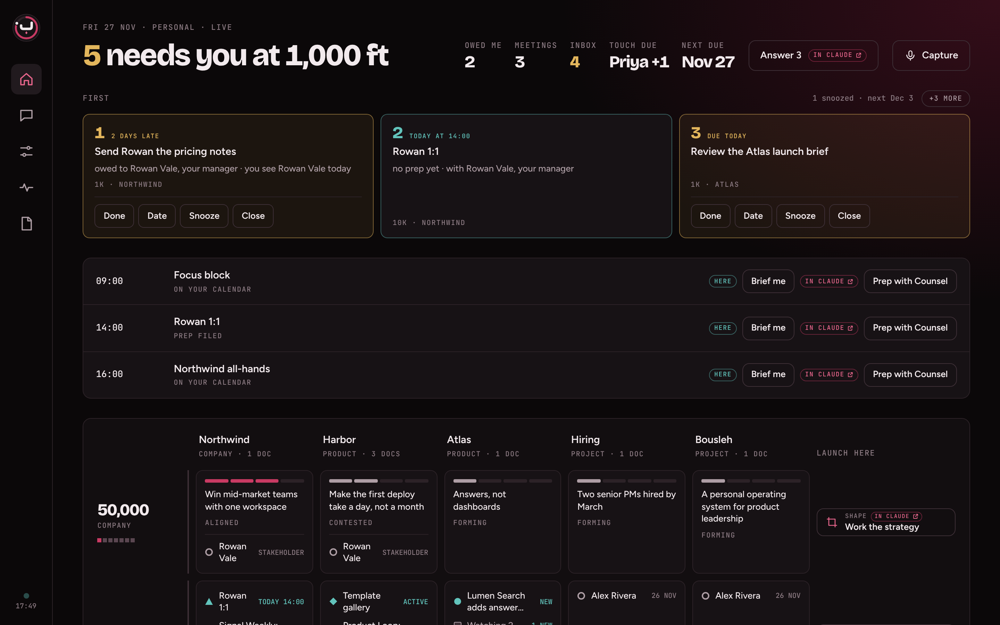
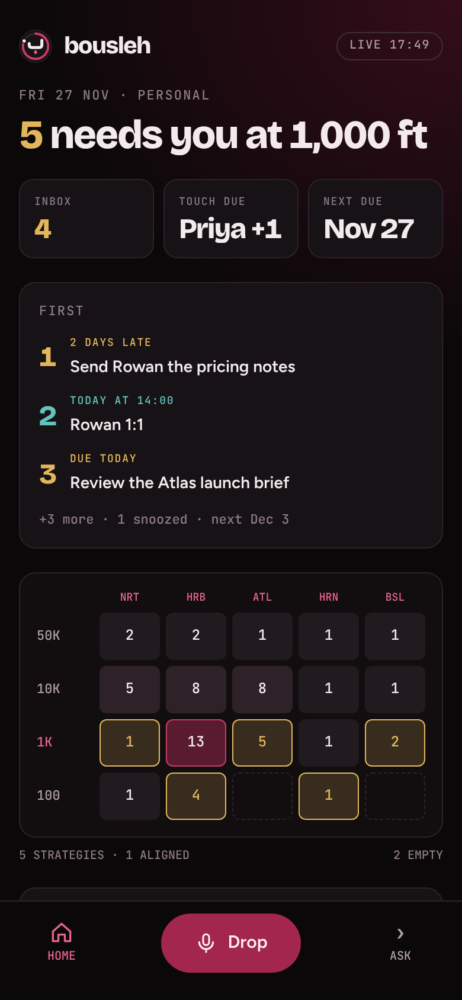
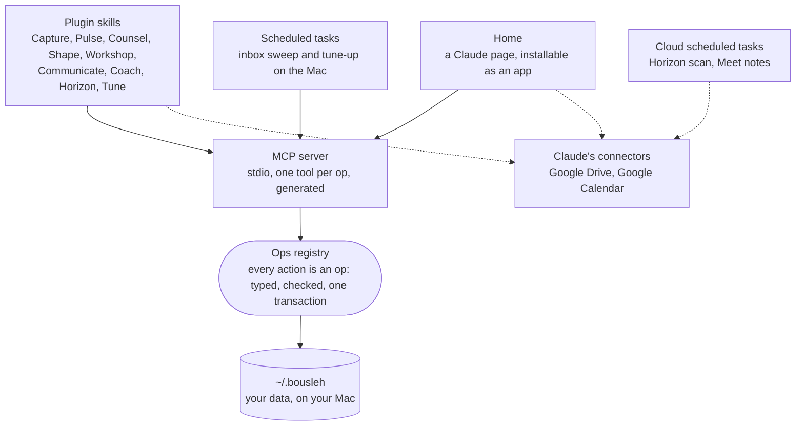

<p align="center">
  <picture>
    <source media="(prefers-color-scheme: dark)" srcset="docs/assets/logo-dark.svg">
    
  </picture>
</p>

<p align="center"><b>بوصلة · compass</b><br>A compass for product leaders, built on Claude.</p>

<p align="center">
  <a href="LICENSE"></a>
  <a href="https://github.com/askoulwassim/bousleh/actions/workflows/ci.yml"></a>
  
  
</p>

<p align="center"></p>

## Why

- **MCP first.** Claude reaches everything through one local MCP server. Claude's own surfaces (chat, Docs, Slides, pages) are the UI.
- **Voice first.** Say it the way it comes out: "I owe Rowan the deck by Friday", "here's the transcript", "where am I?". Answers are short enough to listen to.
- **Your data stays on your Mac.** It lives in `~/.bousleh`, never in this repo, with a daily snapshot beside it.
- **One engine, and every action is an op.** Each op has a name and typed input and output. The MCP server, the skills, Home and the scheduled tasks all call the same ops, so a new door never means new logic.
- **Nine modes at four altitudes.** 50,000 ft is the company, 10,000 the cross-team view, 1,000 your own surfaces, 100 one thing. Each mode works at the altitude the question lives at.

## Personal, and Claude only

Bousleh is built for one person, its owner, and for Claude: Claude's apps, Claude's connectors and a Claude plugin. Issues are welcome, for bugs and ideas. Pull requests from others aren't accepted and are closed automatically. Fork it and make it yours: [CONTRIBUTING.md](CONTRIBUTING.md) says how.

## Try it on demo data

Before you give it your own work, run it on a fictional cast: Alex Rivera, a group PM at Northwind, with Harbor, Atlas and other scopes, strategies, commitments late and due, meetings, a bet, metrics and a week of Horizon findings. It lives in `~/.bousleh-demo`, apart from any real data.

```sh
git clone https://github.com/askoulwassim/bousleh.git ~/Developer/bousleh && cd ~/Developer/bousleh
pnpm install && pnpm demo        # seeds ~/.bousleh-demo
scripts/setup-mac.sh --demo      # adds it to Claude Desktop and Claude Code as "bousleh-demo"
```

Restart Claude Desktop, add the plugin (see below), and say **"Pulse: where am I?"**

To see Home first, with nothing installed in Claude: `pnpm demo:home` serves it on the demo data at http://localhost:4173. `pnpm demo --reset` starts the demo over with fresh dates; `scripts/setup-mac.sh --demo --remove` takes the demo server out again.

## Set it up for real

[SETUP.md](SETUP.md) is the ten-minute walkthrough. In short:

1. `scripts/setup-mac.sh` builds everything, registers the `bousleh` MCP server in Claude Desktop and Claude Code, and installs the plugin in Claude Code. `--check` shows what is set up and changes nothing.
2. It ends by opening Claude's Code tab with **"Finish setting up Bousleh from docs/finish-setup.md."** typed in. Press Enter. On a new Mac it first asks who you are, your first scopes and a starter watch list each ("Bousleh: set me up"); then it publishes Home and creates the scheduled tasks, the same way every time.
3. Add the plugin to your Claude account once: in Claude Desktop, **Customize > Plugins > Add > Add marketplace > Add from a repository**, enter `askoulwassim/bousleh` (or your fork), then add **Bousleh**.
4. Quit Claude Desktop (Cmd-Q) and open it again. Open Home, press **Install as app** in its footer, and allow what you want on its first screen.

To update: `git pull`, rerun `scripts/setup-mac.sh`, and press Enter on the same prompt. It brings everything back in line with the repo.

## The modes

Each mode is a skill in the plugin. Say its name or just say what you need.

| Mode | What it does | Where it runs |
| --- | --- | --- |
| Capture | Files what you say or drop in (dumps, transcripts, inbox files) as typed, linked notes, and queues anything unclear. Also "Bousleh: set me up". | Claude on your Mac; the Hourly inbox sweep |
| Pulse | Where you stand: the few things first, what's due, today's meetings, metrics, findings. Closes and snoozes commitments. | Claude on your Mac; Home |
| Counsel | Prep for a hard conversation: interests, alternatives, where nobody gains by moving, an opener. | Claude on your Mac |
| Shape | Spars on strategy and problems, with the evidence. Bets, decisions, metrics. | Claude on your Mac; Docs |
| Workshop | Ideas against a problem, ranked against your metrics and strategy. | Claude on your Mac; a whiteboard or the scope's Doc |
| Communicate | One truth, rendered for each audience. | Claude on your Mac; Docs, Slides |
| Coach | The PMs you lead: their growth goals, your feedback, the next nudge. | Claude on your Mac; Docs |
| Horizon | The outside view: competitors, news, podcasts, per scope. | Claude on your Mac; Home; the Weekly Horizon scan in the cloud |
| Tune | The Friday tune-up: reviews the week, fixes safe noise, queues judgment calls, opens pull requests for Bousleh itself. | On your Mac, scheduled or from Home |
| Drop | Saves a dictated note to Google Drive for Capture to file later. | Anywhere, the phone included |

## Home

<p align="center">
  
  
</p>

Home is one Claude page: every scope at every altitude, what needs you first, today's meetings and what Horizon found this week. Installed as a Claude app it has its own window, a Dock badge with the needs-you count, a menu bar item and a Capture shortcut (⌥⇧B).

- **Live, in the Claude desktop app:** it reads your data through the `bousleh` server and your calendar through the Google Calendar connector, and acts in place.
- **On the phone and the web:** the last snapshot the desktop app saved, and every button copies its prompt.

Where things happen is a rule, not a setting. **Home does the work** when it is one op on a press (Done, Date, Snooze or Close on a commitment, Save or Skip on a finding, a capture to the inbox, each with Undo), a read-only answer (Ask, in the rail) or a fixed run on this Mac (Tune, health checks). **Claude does the work** when it makes a Claude output, needs a connector or the web, or writes on Claude's judgment: Home opens a new chat with the prompt typed in, and you press Enter. [docs/home.md](docs/home.md) has the details.

## How it works



The MCP server is generated from the ops registry, so the skills, Home and the scheduled tasks all reach your data the same way. Every write runs in one transaction, and nothing is overwritten: history uses "supersedes" links. [AGENTS.md](AGENTS.md) has the packages, the ops each one owns and which skill calls which.

## Privacy

- **On your Mac only:** your data (`~/.bousleh`, folders `0700`, files `0600`) and its daily snapshots (`~/.bousleh-backups`). The MCP server speaks stdio and listens on no port. The engine makes no network calls. Home loads nothing from the network: its fonts are inside the page.
- **Through Claude:** what Claude reads with the tools in a conversation goes to Claude, on your account, like anything else you say. Home's Ask passes Claude only read tools. Home saves one snapshot of what it drew to the page's own storage, readable only by you, so the phone can show it.
- **Through your connectors:** Google Drive holds the "Bousleh Inbox" folder (phone captures, scan results, Meet notes) and the "Bousleh" folder (the watch lists file the scan reads). Google Calendar is read only. Bousleh holds no Google credentials; Claude reaches Google through your connectors.
- **Scheduled tasks:** the Hourly inbox sweep and the Friday tune-up run on your Mac with the Bousleh tools. The Weekly Horizon scan and the Hourly Meet notes mirror run in the cloud and can't reach your Mac: they read and write only Drive files, and the scan searches the web. A scheduled task can see every connector on the account; each task's prompt keeps it to what it needs.

More in [SECURITY.md](SECURITY.md).

## Requirements

- macOS (the setup script and Home's runs are macOS-first), git, Node 22 or newer and pnpm (`corepack enable`, or the setup script installs it).
- The Claude desktop app, and Claude Code (`claude` on the PATH), which the setup registers too and which Tune and publishing Home use.
- A paid Claude plan. Claude Code comes with Pro, Max and Ultra, and with Team and Enterprise ([Claude Code with your plan](https://support.claude.com/en/articles/11145838-use-claude-code-with-your-pro-or-max-plan)). Scheduled tasks are on all paid plans; on Team and Enterprise an admin controls access, and a task that needs your Mac runs only while it is awake with Claude Desktop open ([Schedule recurring tasks](https://support.claude.com/en/articles/13854387-schedule-recurring-tasks-in-claude-cowork)).
- Google Drive and Google Calendar connected to your Claude account, for captures from the phone, the scheduled tasks and today's meetings.

## Docs

- [SETUP.md](SETUP.md): set up a Mac, step by step.
- [AGENTS.md](AGENTS.md): how Bousleh is built, for any agent (or person) working in it.
- [CONTRIBUTING.md](CONTRIBUTING.md): issues, forks, and running your own copy.
- [SECURITY.md](SECURITY.md): reporting a vulnerability, and what Bousleh promises.
- [docs/](docs/): [decisions](docs/decisions.md), [Home](docs/home.md), [scheduled tasks](docs/scheduled-tasks.md), [moving your clone](docs/move.md) and the [design](docs/design/).
- [THIRD_PARTY_NOTICES.md](THIRD_PARTY_NOTICES.md): the fonts and their licenses.

## License

[MIT](LICENSE). The license covers the code and docs; the Bousleh name and logo are not covered.

## Status

v0.2.0. Personal and in daily use; it changes when its owner needs it to. See [CHANGELOG.md](CHANGELOG.md).
